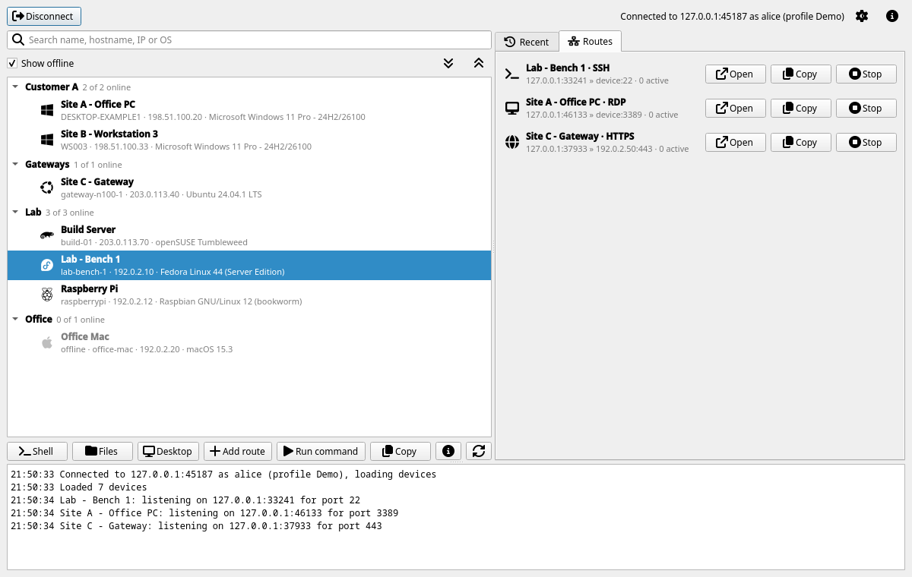
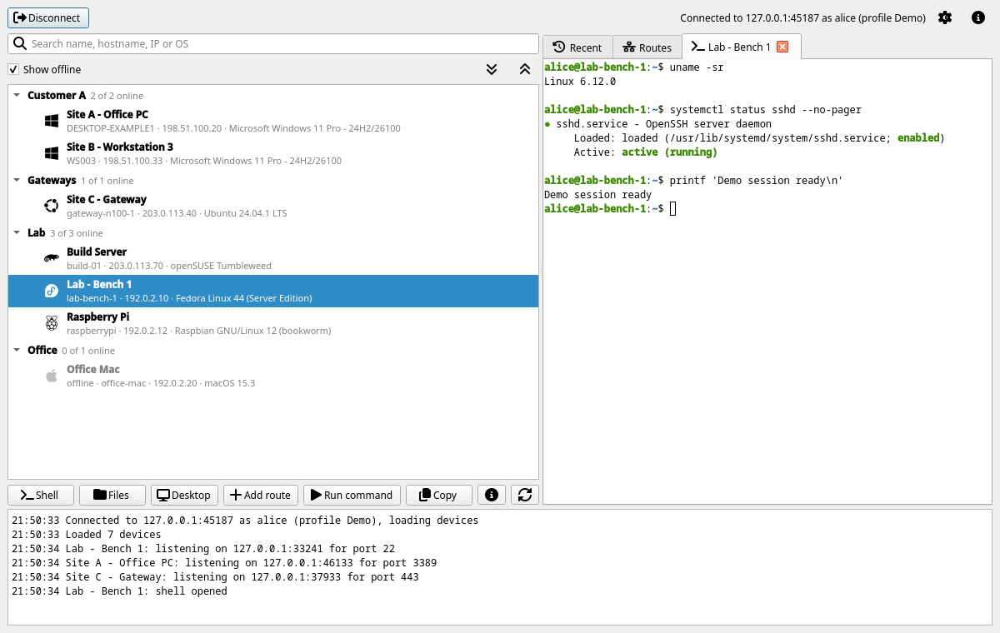
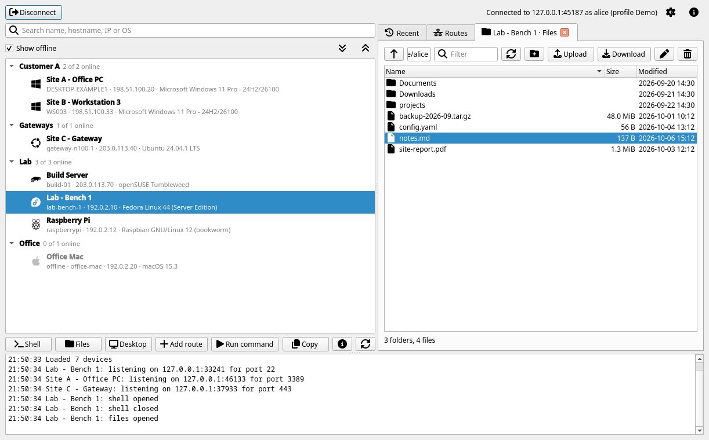
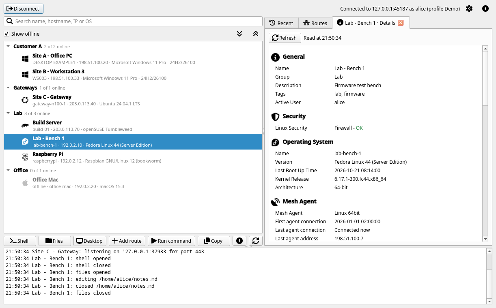

# MeshCentral Client

Simple client for [MeshCentral](https://github.com/Ylianst/MeshCentral) using the WebSocket API. Not affiliated with MeshCentral.

## Features

* List/search devices
* TCP port forwarding (Meshrouter replacement)
* SSH connections with proxy mode support
* Direct shell access (cmd/powershell/bash)
* Run a command on a node, fire and forget
* Device details: system, hardware, network and security status, as in the web UI
* File management: list, upload, download, copy, move, delete
* Multi-profile management
* Single sign-on (OIDC, or any other sign-in the web UI offers) through the browser
* Secure password storage (OS keyring)
* Cross-platform (Windows, Linux, macOS)
* Optional desktop GUI (`mcc-gui`) with multiple simultaneous routes

## Installation
```bash
# Build current platform
make build

# Build all platforms
make build-all

# Or build directly
go build -o mcc
```

### GUI

`mcc-gui` uses the same profiles and keyring as the CLI. Log in, pick a device, and add as many routes as needed, each can be stopped on its own. Double-click a device (or use **Shell**) to open an interactive shell in a tab, with a PowerShell option for Windows devices; **Settings** can make double-click open the device's files, desktop or details, or `ssh`, instead. **Files** opens a tab browsing the device's files: upload (or drop files on the list), download, rename, delete and create folders, with transfers on a channel of their own so browsing never waits for them. Double-click a text file to edit it in its own window; saving writes it in place, so it keeps its owner and permissions, and asks first if the file changed on the device since it was opened. A route's **Open** starts the matching client: the browser for web ports, `ssh` in a terminal window for SSH, and for RDP `mstsc` on Windows or the app registered for `rdp://` links on macOS (Microsoft's Windows App) and Linux (Remmina, KRDC, GNOME Connections). **Copy** gives the device's node ID for the CLI, or a ready-made `~/.ssh/config` block with the `mcc ssh --proxy` ProxyCommand for ssh and VSCode Remote-SSH. Shell, files and desktop tabs and routes are marked when the server records the session. When the device asks its local user to allow access, the tab shows the agent's message until access is granted, and the log at the bottom keeps a line for each session's start, consent, recording and end, along with control connection drops and reconnects. Profiles can log in with [single sign-on](#single-sign-on-oidc) instead of a password. The GUI opens with the profile last connected to, leaving the CLI's default profile as it is, and routes still running at a disconnect or quit reopen on the next connect with that profile, on the same local ports.

**Desktop** opens the device's screen with mouse and keyboard control, display selection, image quality, and fit or actual-size viewing. The clipboard toggle enables automatic bidirectional text sync while that tab and the client window are active; it starts off in each tab, and turning it on sends the local text to the device. Images and files are not transferred. **Type clipboard** remains available for typing text as keystrokes. The fullscreen button (Ctrl+Alt+Enter) hides the client panels and keeps the Desktop toolbar visible; use it again to restore the client. Esc still goes to the remote device. Clipboard support depends on the agent and remote desktop session; some agents do not report an empty remote clipboard.

**Details** (the info button under the device list, or right-click) opens a tab with what the web UI's General and Details tabs show, the same as `mcc details`: group, description, tags and logged-in users, security status (firewall, antivirus, updates, Defender) colored like the web UI, operating system, agent and last connection, network interfaces, BIOS, motherboard, TPM, battery, memory, disks and volumes. Hardware and network details need the *Device details* right and an agent that has reported them. **Refresh** (or F5) reads them again.

Right-click a device or group for **Notes**, the free-text notes MeshCentral keeps for it and shows in the web UI. Device notes can be read by anyone who sees the device and edited with the *Edit notes* right; group notes need the *Edit group* right for both. The server silently ignores requests without the right, so the dialog says when it got no answer or a change wasn't kept. The buttons beside **Show offline** expand or collapse every group in the device list. The gear button opens the **Settings** tab, where changes apply right away: the theme (System, Light or Dark), what double-clicking a device or pressing Enter opens (a shell, its files, its desktop, its details, or `ssh` in a terminal over a route to port 22), and your own **route presets**. A preset has a name, a remote port, an optional target host and the client a route opens with (the browser over HTTP or HTTPS, an SSH terminal or an RDP client). Presets are offered in **Add route** after the built-in ones, and routes to a preset's port take its name and client. They are kept with the GUI's preferences in `mcc-gui.json`, next to the CLI's configuration.

Devices and port routes, connected to the local dummy server with fictional data:

<picture>
  <source media="(prefers-color-scheme: dark)" srcset="docs/screenshots/dark.png">
  
</picture>

An integrated terminal receiving sample output through the dummy server's shell relay:

<picture>
  <source media="(prefers-color-scheme: dark)" srcset="docs/screenshots/dark-shell.png">
  
</picture>

The Files tab browsing a fictional home folder through the dummy server's files channel:

<picture>
  <source media="(prefers-color-scheme: dark)" srcset="docs/screenshots/dark-files.png">
  
</picture>

The Details tab of a fictional Linux device, with the system, agent and hardware information the dummy server reports:

<picture>
  <source media="(prefers-color-scheme: dark)" srcset="docs/screenshots/dark-details.png">
  
</picture>

The GUI uses Qt 6 through miqt and needs cgo and a C++ compiler. For a native build, install the Qt 6 development packages (`qt6-qtbase-devel` on Fedora or `qt6-base-dev` on Debian/Ubuntu):

```bash
make gui          # dist/mcc-gui, linked against the system Qt
make gui-test     # GUI tests using Qt's offscreen platform
make gui-shots    # Start a dummy server and capture both themes in dist/shots
make gui-readme-shots # Regenerate the README images in docs/screenshots
```

Screenshot generation runs offscreen on Linux using the GUI test binary and `tools/guibench`'s local dummy server. It uses temporary preferences and a mock keyring, exercises login, device queries, notes, device details, a shell relay and a files channel, and waits for the device list, terminal output, file listing and details before saving PNGs. No real MeshCentral account, credentials, or desktop session is needed. The images show fictional devices and documentation IP addresses; local server and route ports are assigned automatically.

Cross-platform builds use Podman images in `mcc-gui/package`. Images are built on first use; Windows resource generation uses `go-winres`, pinned in `tools.mod`.

```bash
make gui-linux    # dist/mcc-gui-linux-{amd64,arm64}-<version>.AppImage{,.zsync}
make gui-windows  # dist/mcc-gui-windows-{amd64,arm64}-<version>.{msi,zip}
make gui-macos    # dist/mcc-gui-darwin-{amd64,arm64}-<version>.dmg
make gui-all      # All three platforms
make gui-release  # GUI packages for all three platforms
make release      # CLI binaries + GUI packages + sha256sums.txt
```

Linux releases are Type 2 AppImages containing Qt 6.11.3, X11 and Wayland plugins, supporting libraries, and fallback fonts. GNOME integration includes Adwaita window decorations and the GTK/GSettings backend for desktop theme preferences. Download the matching architecture, make the file executable, and run it; no Qt installation or root access is needed:

```bash
chmod +x mcc-gui-linux-amd64-<version>.AppImage
./mcc-gui-linux-amd64-<version>.AppImage
```

The AppImage also carries the `mcc` CLI. Since an AppImage has no installer, **About**, **Install mcc command** copies it to `~/.local/bin`, which most distributions have on `PATH` (the dialog says so if yours doesn't). After a newer AppImage is started, the button offers **Update mcc command** for a copy from another version, and **Remove mcc command** deletes it.

Each AppImage embeds update information pointing at the latest GitHub release, so Gear Lever and AppImageUpdate find new versions without setup. Publish the `.AppImage.zsync` files next to the AppImages in every release; the updaters look them up by name and AppImageUpdate downloads only the changed blocks.

The supported baseline is glibc 2.39+ (for example, Ubuntu 24.04 or Debian 13) with an X11 or Wayland desktop and the host's graphics drivers. Use the amd64 build on Steam Deck in Desktop Mode; device validation is still pending. Headless servers should use the CLI. Password storage uses the desktop's Secret Service keyring; external SSH, RDP, and browser clients remain system applications.

The [current Type 2 runtime](https://github.com/AppImage/type2-runtime) embeds libfuse, so installing `libfuse2` is unnecessary. If FUSE mounting is unavailable, run `./mcc-gui-linux-amd64-<version>.AppImage --appimage-extract-and-run`. This extracts to a temporary directory and cleans it up on exit. Each package run downloads the latest continuous appimagetool and runtime, so upstream fixes arrive without rebuilding the build image.

Windows packages come as a per-user `.msi` installer and as the same static executable in a `.zip`. The installer shows the license, installs without admin rights, and offers to start the app when done. It installs the GUI and the `mcc` CLI into `%LOCALAPPDATA%\Programs\MeshCentral Client`, adds that folder to the user's `PATH` (new terminals find `mcc`), adds a Start menu entry, and registers the app for the single sign-on `mcrouter://` links; installing a newer version replaces the old one, and uninstalling (Settings, Apps) removes all of it. The `.zip` is for running without installing.

macOS packages are `.dmg` disk images for macOS 14 or later: open it and drag MeshCentral Client to the Applications folder. The app bundles Qt and is ad-hoc signed but not notarized (that needs a paid Apple Developer ID), so the first launch is blocked; open **System Settings**, **Privacy & Security**, and click **Open Anyway** once. From then on it opens normally, and the web UI's single sign-on `mcrouter://` links open it. The app also carries the `mcc` CLI: **About**, **Install mcc command** links it into `/usr/local/bin` after asking for an admin password, and **Update mcc command** points the link at the app again after it moved. To uninstall, use **Remove mcc command** there first (or `sudo rm /usr/local/bin/mcc`), then move the app to the Trash.

On Linux, `make gui-bench` measures CPU and memory against the dummy MeshCentral server. `make gui-soak` runs a 30-minute test with 16,000 devices and two active shells in headless Mutter. Pass `BENCH_FLAGS` for benchmark options, `SOAK` for duration, and `HIDE=` to render the window during a soak.

GUI icons are from [Font Awesome Free](https://fontawesome.com) by Fonticons, Inc., licensed under [CC BY 4.0](https://creativecommons.org/licenses/by/4.0/).

The CLI build does not link Qt and stays cgo-free.

## Usage
```bash
# Interactive device search
mcc search

# List all online devices
mcc ls

# TCP port forwarding
mcc route -L 8080:127.0.0.1:80 -i <nodeid>
mcc route -L 8080:80              # Interactive search, omit target IP
mcc route -L 80                   # Random local port
mcc route -L 0.0.0.0:8080:127.0.0.1:80 -i <nodeid>  # Listen on all local interfaces
mcc route -L '[::1]:8080:[::1]:80' -i <nodeid>      # IPv6 loopback on both ends

# SSH (interactive mode)
mcc ssh -i <nodeid>
mcc ssh user@192.168.1.1 -i <nodeid>  # SSH to network device via mesh node

# SSH proxy mode (VSCode Remote, etc.)
mcc ssh -i <nodeid> --proxy

# Direct shell access
mcc shell -i <nodeid>              # Linux/Mac: bash, Windows: cmd
mcc shell -i <nodeid> --powershell # Windows: PowerShell

# Run a command, fire and forget (no output returned)
mcc run -i <nodeid> "rename computer new-hostname"
mcc run -i <nodeid> --as-user "notify-send hello" # as logged-in user instead of SYSTEM/root

# Device details: what the web UI's General and Details tabs show
mcc details -i <nodeid>            # OS, agent, network, hardware, disks; security status in color
mcc details -i <nodeid> --json     # the server's data as is, for scripts

# Files (remote paths are absolute: /home/user, C:\Users)
# Leave out -i or a remote path to pick it interactively, e.g. `mcc files get`
mcc files ls -i <nodeid> /var/log         # ls with no path lists the drives on Windows
mcc files get -i <nodeid> /etc/hosts .    # several files go into a local folder
mcc files get -i <nodeid> /etc/hosts - | grep localhost
mcc files put -i <nodeid> a.txt b.txt /tmp
echo hi | mcc files put -i <nodeid> - /tmp/hi.txt
mcc files mkdir|rm [-r]|mv|cp -i <nodeid> ...  # cp copies files only, the agent can't copy folders

# Profile management
mcc profile add -n work -s mesh.company.com -u admin -p password
mcc profile add -n sso -s mesh.company.com --sso  # Single sign-on, no password
mcc profile list
mcc profile default work
mcc profile rm work

# View config location
mcc config
```

### Port Forward Format
```
[bind_address:]localport:target:remoteport
localport:remoteport
target:remoteport
remoteport
```

- `bind_address` - Optional, local interface to listen on, defaults to `127.0.0.1`. Use `0.0.0.0` for all IPv4 interfaces or `[::]` for all IPv6 interfaces. Only valid in the 4-part form
- `localport` - Optional, random if omitted
- `target` - Optional, host reachable from the mesh node, defaults to the node itself (`127.0.0.1`)
- `remoteport` - Required

Examples:
- `127.0.0.1:3389:127.0.0.1:3389` - Local 127.0.0.1:3389 to the node's RDP port
- `0.0.0.0:8080:192.168.1.1:80` - Local 8080 on all interfaces to 192.168.1.1:80 via the node
- `8080:192.168.1.1:80` - Local 127.0.0.1:8080 to 192.168.1.1:80 via the node
- `8080:80` - Local 127.0.0.1:8080 to port 80 on the node
- `192.168.1.1:80` - Random local port to 192.168.1.1:80 via the node
- `80` - Random local port to port 80 on the node

Enclose IPv6 bind addresses and targets in brackets, and quote the specification to keep the shell from interpreting them:

```bash
mcc route -L '[::1]:8080:127.0.0.1:80' -i <nodeid> # Local IPv6 listener, remote IPv4 target
mcc route -L '8080:[2001:db8::10]:80' -i <nodeid>  # IPv6 target reachable from the node
mcc route -L '[2001:db8::10]:80' -i <nodeid>       # IPv6 target, random local port
mcc route -L '[::]:8080:[::1]:80' -i <nodeid>      # All local IPv6 interfaces
```

Scoped addresses such as `[fe80::1%eth0]` are accepted. A bind address's scope names a local interface; a target's scope names an interface on the mesh node. Explicit `::1` targets remain IPv6 loopback rather than falling back to the node's IPv4 default. The node must have IPv6 connectivity to the target.

For a MeshCentral server specified by IPv6 address, use `[2001:db8::1]` or `[2001:db8::1]:8443` in the profile's server field. The SSH command accepts a bare IPv6 target after the username, for example `mcc ssh 'user@2001:db8::10' -i <nodeid>`.

## Flags

### Global
- `-C, --config` - Alternate config file
- `-P, --profile` - Override active profile
- `-t, --token` - 2FA token
- `-k, --insecure` - Skip TLS certificate verification (testing only)
- `--debug` - Enable debug logging

### Command-Specific
- `-i, --nodeid` - Target device ID, with or without the `node//` prefix (omit for interactive search)
- `-L, --bind-address` - Port forward specification (route)
- `-p, --port` - SSH remote port, default 22 (ssh)
- `--proxy` - SSH proxy mode for ProxyCommand (ssh)
- `--powershell` - Use PowerShell instead of cmd.exe (shell)
- `--as-user` - Run as the logged-in user instead of SYSTEM/root (run)
- `--json` - Print JSON instead of text (details, files ls)
- `--sso` - Log in with single sign-on instead of a username and password (profile add)

## 2FA Authentication

If the MeshCentral server requires two-factor authentication, mcc handles it automatically.

**Interactive prompt** - when no token is provided, mcc will prompt after the initial connection attempt:
```
WARNING  2FA required.
Enter 2FA token: ******
```

**Inline token** - pass the token directly to skip the prompt, useful for scripting or when the token is already known:
```bash
mcc ssh -i <nodeid> --token 123456
mcc shell -i <nodeid> --token 123456
mcc route -L 8080:80 -i <nodeid> --token 123456
```

**Email/SMS tokens** - if the server supports out-of-band tokens, type `email` or `sms` at the prompt to request one, then re-enter the prompt with the received code:
```
WARNING  2FA required. Enter a token or type 'email'/'sms' to request one.
Enter 2FA token: email
WARNING  2FA required.
Enter 2FA token: 123456
```

**Remembered login** - after a successful 2FA login, mcc (and mcc-gui) asks the server for its "remember this device" cookie and stores it in the OS keyring next to the profile's password. Later logins with that profile, and reconnects after a network drop, skip the token prompt until the cookie expires (the server's `twoFactorCookieDurationDays`, 30 days by default) or is rejected, then you're prompted again. The password is still required. `mcc profile rm` deletes the cookie with the profile.

## Single sign-on (OIDC)

For accounts that sign in to MeshCentral through OIDC (or SAML, Azure, Google and the other sign-in methods the web UI offers), create the profile with `--sso`, or tick **Log in with single sign-on** in the GUI's profile dialog. There is no password to store: MeshCentral only completes these sign-ins in a browser, so the client takes over the browser's session through the web UI's **Launch MeshCentral Router** link, then trades it for a MeshCentral login token. The token is valid for 30 days and stored in the OS keyring; until it expires or is revoked, logins and reconnects need no browser. The CLI and GUI share it through the profile.

**Getting the link** - sign in to the web UI, click **Router** below the device list, then **Launch MeshCentral Router**. The link looks like `mcrouter://mesh.company.com/control.ashx?c=...`.

> **Linux:** MeshCentral currently shows the Router link only to Windows and macOS browsers. On Linux, open the browser's developer console (F12, **Console** tab) on the MeshCentral page and run:
> ```js
> p10showMeshRouterDialog()
> ```
> This opens the same dialog with the **Launch MeshCentral Router** button.

**CLI** - when a login is needed, mcc opens the web UI in the browser and asks for the link. Right-click **Launch MeshCentral Router**, copy the link and paste it; like a password, it isn't echoed:
```
INFO  Single sign-on: sign in at https://mesh.company.com/ (opened in your browser), click Router on the devices page and copy the link of the Launch MeshCentral Router button.
Router link (hidden):
```

**GUI** - **Connect** opens the browser and a dialog that accepts the pasted link. For one click, press **Open Router links with this app** in that dialog once: clicking **Launch MeshCentral Router** then hands the sign-in to mcc-gui directly, starting it if needed and connecting the SSO profile for that server, or offering to add one. This registers mcc-gui for `mcrouter://` links for the current user (a desktop entry and `xdg-mime` on Linux, `HKCU\Software\Classes` on Windows), replacing MeshCentral Router if it is installed; register again after moving the executable. The Windows installer, the macOS app and AppImages integrated by tools such as Gear Lever register the link type themselves.

A link is valid for an hour and only from the IP address of the browser it came from, so copy it on the same machine. If the server disables login tokens (`passwordRequirements.loginTokens: false`), the session still works but every login needs the browser. `mcc profile rm` deletes the token locally; it stays listed under the account's login tokens in the web UI, where it can be removed, until it expires.

> **Note:** Node IDs containing special characters (e.g. `$`) must be wrapped in single quotes to prevent shell expansion:
> ```bash
> mcc ssh -i 'node//abc$def...'
> mcc ssh -i 'abc$def...'   # node// prefix is optional
> ```
>
> The same applies to `ProxyCommand` in `~/.ssh/config`. Use single quotes, since OpenSSH runs it through `sh -c`. Some launchers (e.g. VSCodium's open-remote-ssh) spawn it without a shell and pass the quotes through literally; mcc strips them, so single quotes work in both:
> ```
> Host my-node
>   User root
>   ProxyCommand mcc ssh -i 'node//abc$def...' --proxy
> ```

## Security

**Password Storage Migration (v1.0+)**

Passwords now stored in OS-native secure storage:
- **Linux**: Secret Service API (gnome-keyring/kwallet)
- **macOS**: Keychain
- **Windows**: Credential Manager

Existing plaintext passwords migrate automatically on first run. Config file only stores server/username. Single sign-on profiles keep their login token in the same keyring.

**TLS Verification**

Use `--insecure` only for testing with self-signed certificates. Not recommended for production.

## Configuration

Default config: `~/.config/mcc/meshcentral-client.json`

Profiles store server URL, username. Passwords stored separately in system keyring.

## Development
```bash
make build        # Build current platform
make build-all    # Cross-compile all platforms
make version      # Show version info
make clean        # Remove build artifacts
```

## License

MIT License - see [LICENSE](LICENSE)
